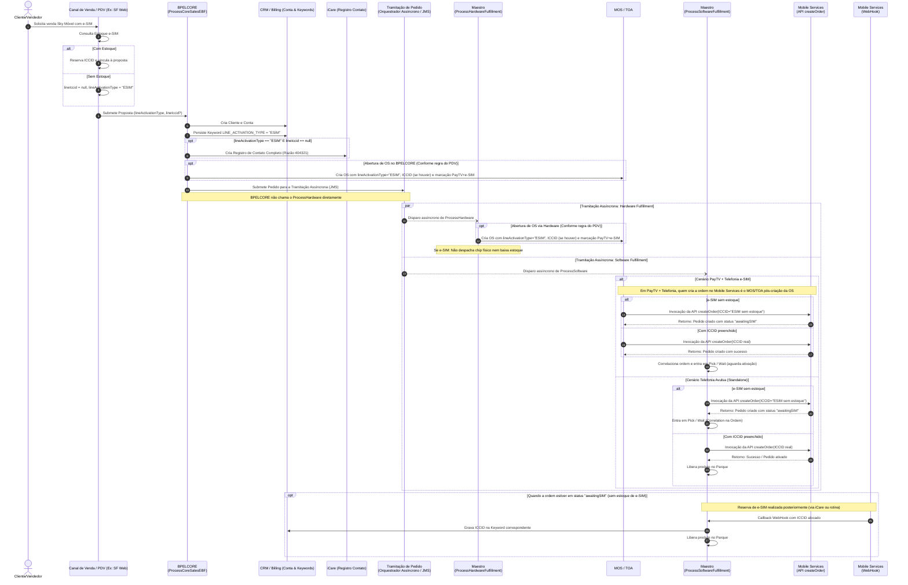

# ESPECIFICAÇÃO TÉCNICA - SOA SUITE

| Informação | Detalhe |
| :--- | :--- |
| **Projeto** | `26.0019.MK` - Sky Móvel - Venda e-SIM |
| **Componentes Impactados** | BPELCORE (`ProcessCoreSalesEBF`), Maestro (`ProcessHardwareFulfillmentOrder`, `ProcessSoftwareFulfillmentOrder`) |
| **Tecnologia** | Oracle SOA Suite (BPEL 11g/12c, Mediator, WSDL/XSD, JMS) |
| **Versão** | 1.0 |
| **Status** | Pronto para Desenvolvimento |
| **Data** | 21/10/2026 |

---

## 1. Visão Geral e Contexto de Negócio

### 1.1. Objetivo e Premissas Arquiteturais
Atender à comercialização da nova modalidade **Sky Móvel com tecnologia e-SIM**, abrangendo tanto os cenários em que há estoque de e-SIM no momento da venda (via Salesforce Web / PDVs) quanto os cenários em que não há estoque imediato.

#### Premissas Arquiteturais do Ambiente SOA Suite:
1. **Criação de Ordem de Serviço (OS) no MOS / TOA por PDV**:
   - A criação da OS no TOA pode ser realizada tanto pelo **BPELCORE** quanto pelo **ProcessHardwareFulfillmentOrder**, dependendo da origem/regra do PDV (Canal de Venda).
   - Em ambos os fluxos, a OS deve receber `lineActivationType`, `lineIccid` (se preenchido) e a marcação de venda conjunta PayTV + e-SIM.
2. **Criação da Ordem no Mobile Services em Vendas Conjuntas**:
   - Em vendas de PayTV + Sky Móvel (Telefonia), quem cria a ordem no Mobile Services é o **MOS / TOA após a criação da OS**.
   - Em vendas solo de Telefonia, quem cria a ordem no Mobile Services é o **ProcessSoftwareFulfillmentOrder** (Maestro).

---

## 2. Diagrama de Sequência de Ponta a Ponta



---

## 3. Especificação Técnica: BPELCORE (`ProcessCoreSalesEBF`)

### 3.1. Alterações no Contrato de Interface (Schema / XSD)
No Enterprise Business Message (EBM) de entrada de vendas (`ProcessCoreSalesEBF_Req.xsd` ou equivalente do domínio de Sales Order):

```xml
<!-- Elemento no nível de item de linha móvel (ex: LineItem / MobileServiceItem) -->
<xsd:element name="lineActivationType" type="xsd:string" minOccurs="0">
    <xsd:annotation>
        <xsd:documentation>
            Tipo de ativação da linha móvel. 
            Valores esperados: "SIM_CARD" (Físico), "ESIM" (Virtual).
        </xsd:documentation>
    </xsd:annotation>
</xsd:element>
```

---

### 3.2. Regra 1: Persistência de Keyword na Conta
- **Ação**: Durante a criação/atualização da Conta do Cliente no Billing/CRM (ex: BSCS, Kenan ou Siebel via EBS de Customer Management).
- **Condição**: Sempre que o campo `lineActivationType` for informado.
- **Mapeamento de Keyword**:
  - `Keyword_Name`: `LINE_ACTIVATION_TYPE`
  - `Keyword_Value`: Valor recebido em `lineActivationType` (Ex.: `"ESIM"`).

---

### 3.3. Regra 2: Criação de Registro de Contato no iCare Clientes
- **Condição de Disparo**:
  ```xpath
  ($inputVariable.payload//ns1:lineActivationType = 'ESIM') and 
  (string-length($inputVariable.payload//ns1:lineIccid) = 0 or 
   not($inputVariable.payload//ns1:lineIccid) or 
   $inputVariable.payload//ns1:lineIccid/@xsi:nil = 'true')
  ```
- **Frequência**: Executar **1 única vez** no momento da criação do Cliente/Conta.
- **Tipo de Registro**: `Completo` (Contact Record síncrono ou assíncrono via `CreateCustomerInteractionEBS` / iCare Adapter).
- **Mapeamento dos Campos do Registro de Contato**:

| Campo iCare / Interaction EBM | Valor Fixo / Mapeado | Descrição |
| :--- | :--- | :--- |
| `ReasonCode` / Razão | `404321` | NAO FOI POSSIVEL REALIZAR A RESERVA DE ESTOQUE DO "E-SIM" |
| `Category` / Categoria | `TECNICO` | Categoria de atendimento |
| `SubCategory` / Sub Categoria | `MVNO SURF` | Subcategoria referente à operadora parceira |
| `ManifestationType` / Manifestação | `Informação` | Tipo de manifestação |
| `CustomerId` / `AccountId` | ID do Cliente / Conta gerado | Identificador do cliente no CRM |
| `Description` / Texto complementar | `"Venda Sky Móvel e-SIM realizada sem reserva imediata de estoque. Linha aguardando disponibilidade para posterior ativação."` | Texto descritivo da interação |

> [!IMPORTANT]
> A chamada para o iCare deve ser protegida por tratamento de falhas (Fault Handling) para que eventuais indisponibilidades do serviço de registro de contato não impeçam a conclusão da criação da Conta/Pedido no fluxo principal do BPELCORE (gravar log de auditoria / compensação se necessário).

---

### 3.4. Regra 3: Ajuste no Fluxo de Criação de OS pelo BPELCORE (Conforme PDV)
- **Contexto Arquitetural**: A criação da Ordem de Serviço (OS) no MOS/TOA pode ser disparada **pelo BPELCORE ou pelo `ProcessHardwareFulfillmentOrder`**, dependendo da parametrização do canal de venda / PDV de origem.
- **Regras quando a OS for criada pelo BPELCORE**:
  1. **Flag de Ativação**: Mapear `lineActivationType` para o campo correspondente no TOA/MOS (ex: `lineActivationType = "ESIM"`).
  2. **Envio de ICCID**: Enviar o campo `ICCID` somente se preenchido; se nulo, omitir ou enviar nulo/vazio.
  3. **Identificação e Observação da OS (Work Order Notes / Special Instructions)**:
     - Para vendas conjuntas de PayTV com Sky Móvel A La Carte (e-SIM), marcar a OS para identificação no MOS/TOA (`isESimSale = "true"`).
     - Inserir no campo de Observação para o Técnico / Credenciado:
       ```text
       [SKY MOVEL - E-SIM]: Cliente adquiriu Sky Movel com e-SIM. Ativacao ocorrera automaticamente apos habilitacao do PayTV. NAO coletar e NAO baixar estoque de chip fisico (ICCID).
       ```
  4. **Criação da Ordem no Mobile Services pós-OS**:
     - No fluxo de venda combinada (PayTV + Telefonia), **o MOS / TOA é o responsável por invocar a API `createOrder` no Mobile Services logo após a criação da OS**.
     - Se o e-SIM estiver sem estoque, o MOS/TOA envia `"ESIM sem estoque"` no ICCID para que a ordem no Mobile Services fique com status `"awaitingSIM"`.

---

## 4. Especificação Técnica: Maestro

### 4.1. Componente: `ProcessHardwareFulfillmentOrder`

#### Alterações no Fluxo:
1. **Abertura de OS no MOS / TOA (Quando executada via Hardware / PDV)**:
   - Para os PDVs cuja abertura de OS é de responsabilidade da esteira de hardware:
     - Repassar `lineActivationType = "ESIM"` ao TOA/MOS.
     - Enviar `lineIccid` apenas se estiver preenchido.
     - Marcar a OS com a flag de e-SIM e incluir a instrução padronizada na observação da OS para o credenciado/técnico.

---

### 4.2. Componente: `ProcessSoftwareFulfillmentOrder`

#### Alterações no Fluxo:
1. **Verificação de Ativação e Estoque**:
   - Condição de análise:
     ```xpath
     $orderItem/ns:lineActivationType = 'ESIM'
     ```
2. **Invocação da API `createOrder` do Mobile Services**:
   - **Venda Conjunta (PayTV + Telefonia)**: 
     - Quem cria a ordem no Mobile Services é o **MOS / TOA**, logo após a criação da Ordem de Serviço (OS).
     - O `ProcessSoftwareFulfillmentOrder` (Maestro) correlaciona a ordem gerada e entra diretamente no fluxo de espera (`<pick>`) aguardando a conclusão da ativação da linha móvel.
   - **Venda Avulsa (Apenas Telefonia Móvel)**:
     - O próprio `ProcessSoftwareFulfillmentOrder` (Maestro) invoca a API `createOrder` do **Mobile Services**.
     - Se `lineActivationType == 'ESIM'` e o ICCID for **nulo ou vazio**:
       - Envia no payload da API o campo `ICCID` com o valor literal `"ESIM sem estoque"`.
       - A API `createOrder` registra o pedido no Mobile Services com status `"awaitingSIM"`.
       - O Maestro entra em atividade de espera (`<pick>`).
     - Se `lineIccid` estiver preenchido: envia o ICCID real e segue o provisionamento imediato.

3. **Mecanismo de Espera (Pick / Receive Assíncrono)**:
   - Após o `createOrder` com status `awaitingSIM`, o BPEL do `ProcessSoftwareFulfillmentOrder` deve entrar em uma atividade `<receive>` correlacionada (ou `<pick>`) aguardando notificação:
     - **Branch 1 (Sucesso - Ativação e-SIM)**:
       - Disparado pelo WebHook de Mobile Services (`MobileServicesWebHook`) após o cliente ou operador efetuar a reserva/ativação (via Tela de Telefonia do iCare Clientes ou rotina de fila).
       - Payload recebido: `OrderNumber`, `ICCID`, `Status = "ACTIVE"`.
       - Ação do Maestro:
         - Gravar o `ICCID` definitivo na Keyword correspondente da conta.
         - Liberar a conclusão do produto no Parque (Instalação/Parque de Serviços).
         - Finalizar o fulfillment com sucesso.
     - **Branch 2 (Cancelamento do Pedido)**:
       - Se o pedido for cancelado por desistência ou expiração de tempo limite (Timer / SLA configurável).
       - Executar rotina de cancelamento e limpeza de recursos pendentes.

---

## 5. Matriz de De-Para (Data Mapping)

### 5.1. BPELCORE (`ProcessCoreSalesEBF`)

| Campo de Origem (SF Proposal) | Campo de Destino (EBM / Target) | Transformação / Regra |
| :--- | :--- | :--- |
| `Proposal.lineActivationType` | `CoreSalesEBM/LineItem/lineActivationType` | Mapeamento direto (`"ESIM"` ou `"SIM_CARD"`) |
| `Proposal.lineIccid` | `CoreSalesEBM/LineItem/lineIccid` | Mapeamento direto (pode vir nulo) |
| `lineActivationType = "ESIM"` | CRM Account Keywords: `LINE_ACTIVATION_TYPE` | Inserir keyword na conta com valor `"ESIM"` |
| `lineActivationType = "ESIM"` E `lineIccid IS NULL` | `CreateInteractionEBM/ReasonCode` | Fixo: `404321` |
| `lineActivationType = "ESIM"` E `lineIccid IS NULL` | `CreateInteractionEBM/Category` | Fixo: `"TECNICO"` |
| `lineActivationType = "ESIM"` E `lineIccid IS NULL` | `CreateInteractionEBM/SubCategory` | Fixo: `"MVNO SURF"` |
| `lineActivationType = "ESIM"` E `lineIccid IS NULL` | `CreateInteractionEBM/Manifestation` | Fixo: `"Informação"` |
| `lineActivationType = "ESIM"` | TOA Work Order: `lineActivationType` | Repassar `"ESIM"` para MOS/TOA |
| `lineIccid` | TOA Work Order: `lineIccid` | Se preenchido, repassar; se nulo, omitir |
| Venda PayTV + e-SIM A La Carte | TOA Work Order: `workOrderRemarks` | Concatenar texto padronizado informando e-SIM |

### 5.2. Maestro (`ProcessSoftwareFulfillmentOrder`)

| Cenário de Entrada | Campo `ICCID` no `createOrder` | Status Resultante da Ordem |
| :--- | :--- | :--- |
| `lineActivationType == 'ESIM'` E `lineIccid` preenchido | Valor real de `lineIccid` | Fluxo normal de ativação imediata |
| `lineActivationType == 'ESIM'` E `lineIccid` nulo/vazio | `"ESIM sem estoque"` | `"awaitingSIM"` (Aguarda WebHook) |
| `lineActivationType != 'ESIM'` | Valor real de `lineIccid` (obrigatório para SIM físico) | Fluxo padrão de chip físico |

---

## 6. Tratamento de Exceções e Resiliência

1. **Falha na criação do Registro de Contato (iCare)**:
   - Configurar Fault Policy com 3 tentativas de retry (intervalo exponencial).
   - Se a falha persistir, registrar em log com severidade WARNING e prosseguir com a venda (não bloquear a esteira de vendas do cliente por indisponibilidade do iCare).
2. **Timeout no Maestro (`awaitingSIM`)**:
   - Definir período de espera no `<pick>` do BPEL (ex: 30 dias ou de acordo com a política de validade de proposta da SKY).
   - Ao estourar o timer, enviar notificação de falha por expiração para cancelamento seguro da ordem de software.
3. **Idempotência no WebHook**:
   - Garantir que o recebimento de notificações duplicadas do `MobileServicesWebHook` (com mesmo `OrderNumber` e `ICCID`) seja tratado de forma idempotente, evitando duplicidade na ativação do parque.

---

## 7. Rastreabilidade de Requisitos

| Requisito | Descrição | Componente Responsável | Status da Cobertura |
| :---: | :--- | :--- | :---: |
| **R1** | Consulta/reserva no SF e transição ao BPEL Core sem ICCID se sem estoque | SF Web / BPELCORE | Coberto no item 3.1 e 3.2 |
| **R2** | Reserva manual via iCare e desbloqueio do pedido via WebHook | iCare / Mobile Services / Maestro SW | Coberto no item 4.2 |
| **R3** | Registro de Contato Completo informando falta de estoque de e-SIM | BPELCORE (`ProcessCoreSalesEBF`) | Coberto no item 3.3 |
| **R4** | Ajuste na OS para não gerar OS de e-SIM e marcar OS de PayTV no TOA | BPELCORE / Maestro HW / MOS / TOA | Coberto no item 3.4 e 4.1 |

---

## 8. Plano de Testes Integrados (Casos de Teste)

| ID | Cenário de Teste | Dados de Entrada | Resultado Esperado |
| :--- | :--- | :--- | :--- |
| **TC-01** | Venda e-SIM **sem** estoque (Linha Avulsa) | `lineActivationType = "ESIM"`, `lineIccid = null` | - Conta criada com keyword `LINE_ACTIVATION_TYPE = "ESIM"`<br/>- Registro de contato gerado com razão `404321`<br/>- Ordem de Software criada com ICCID `"ESIM sem estoque"` e status `"awaitingSIM"` |
| **TC-02** | Venda e-SIM **com** estoque (Linha Avulsa) | `lineActivationType = "ESIM"`, `lineIccid = "8955..."` | - Conta criada com keyword `LINE_ACTIVATION_TYPE = "ESIM"`<br/>- **Não** cria registro de contato `404321`<br/>- Ordem de Software ativada imediatamente com o ICCID real |
| **TC-03** | Venda Conjunta PayTV + e-SIM sem estoque | PayTV + Sky Móvel (`"ESIM"`, `lineIccid = null`) | - OS de PayTV gerada no TOA com observação informando que o e-SIM será ativado após habilitação<br/>- Não é solicitada digitação nem baixa de ICCID pelo técnico |
| **TC-04** | Liberação de Ordem via WebHook | Callback com `OrderNumber` e novo `ICCID` | - Maestro retoma a partir do status `"awaitingSIM"`<br/>- Grava novo ICCID na keyword da conta<br/>- Libera produto no Parque com sucesso |
| **TC-05** | Venda Tradicional (Chip Físico) | `lineActivationType = "SIM_CARD"`, `lineIccid = "8955..."` | - Comportamento legado mantido sem regressão |
