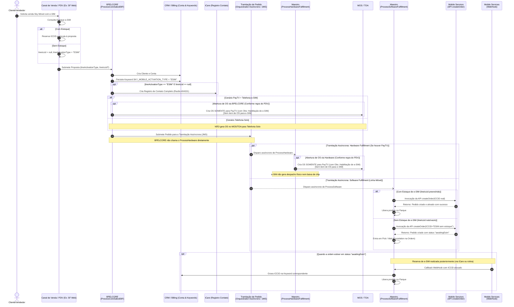

# ESPECIFICAÇÃO TÉCNICA - SOA SUITE

| Informação | Detalhe |
| :--- | :--- |
| **Projeto** | `26.0019.MK` - Sky Móvel - Venda e-SIM |
| **Componentes Impactados** | BPELCORE (`ProcessCoreSalesEBF`), Maestro (`ProcessHardwareFulfillmentOrder`, `ProcessSoftwareFulfillmentOrder`) |
| **Tecnologia** | Oracle SOA Suite (BPEL 11g/12c, Mediator, WSDL/XSD, JMS) |
| **Versão** | 1.1 |
| **Status** | Pronto para Desenvolvimento (Regra de e-SIM Atualizada) |
| **Data** | 22/10/2026 |

---

## 1. Visão Geral e Novas Regras de Negócio

### 1.1. Regra Atualizada de Geração de Ordem de Serviço (OS) para e-SIM
1. **Cenário Telefonia Solo (Avulsa / Standalone)**:
   - **NÃO GERA ORDEM DE SERVIÇO (OS)**.
   - Nenhuma OS é enviada ao MOS/TOA, independentemente do canal/PDV.
   - O fluxo segue diretamente para o provisionamento via API `createOrder` (Mobile Services) executado pelo `ProcessSoftwareFulfillmentOrder`.
2. **Cenário Venda Conjunta (PayTV + Telefonia e-SIM)**:
   - A Ordem de Serviço (OS) no MOS/TOA é gerada **EXCLUSIVAMENTE para os equipamentos/itens de PayTV**.
   - **NÃO criar item de OS para o e-SIM**: Tanto o BPELCORE quanto o `ProcessHardwareFulfillmentOrder` devem filtrar e suprimir a criação de itens de linha de telefonia móvel e-SIM na OS.
   - **Observação na OS do PayTV**: Incluir no campo de observação/instrução da OS a mensagem informando que se trata de uma venda com habilitação de e-SIM (não cobrar/baixar chip físico).

### 1.2. Regra Atualizada de Integração com Mobile Services (`createOrder`)
- A responsabilidade de integração com a API `createOrder` do Mobile Services é do componente **`ProcessSoftwareFulfillmentOrder` (Maestro)** (disparado assincronamente pela esteira de tramitação de pedidos):
  - **Quando TIVER estoque de e-SIM** (`lineIccid` preenchido):
    - Realiza a **ativação normal**, enviando o número real do ICCID no `createOrder`.
    - Prossegue para liberação imediata no Parque.
  - **Quando NÃO tiver estoque de e-SIM** (`lineIccid` nulo ou vazio):
    - Informa no campo de ICCID o valor literal: `"ESIM sem estoque"`.
    - A ordem é criada no Mobile Services com status: `"awaitingEsim"`.
    - O Maestro entra em espera assíncrona (`<pick>`) aguardando a notificação do WebHook do Mobile Services após futura reserva do e-SIM (via iCare Clientes ou rotina de esteira).

---

## 2. Diagrama de Sequência de Ponta a Ponta



---

## 3. Especificação Técnica: BPELCORE (`ProcessCoreSalesEBF`)

### 3.1. Alterações no Contrato de Interface (Schema / XSD)
No Enterprise Business Message (EBM) de entrada de vendas (`ProcessCoreSalesEBF_Req.xsd` ou equivalente do domínio de Sales Order):

```xml
<!-- Elemento no nível de item de linha móvel (ex: LineItem / MobileServiceItem) -->
<xsd:element name="lineActivationType" type="xsd:string" minOccurs="0">
    <xsd:annotation>
        <xsd:documentation>
            Tipo de ativação da linha móvel. 
            Valores esperados: "SIM_CARD" (Físico), "ESIM" (Virtual).
        </xsd:documentation>
    </xsd:annotation>
</xsd:element>

```

---

### 3.2. Regra 1: Persistência de Keyword na Conta
- **Ação**: Durante a criação/atualização da Conta do Cliente no Billing/CRM (ex: BSCS, Kenan ou Siebel via EBS de Customer Management).
- **Condição**: Sempre que o campo `lineActivationType` for informado.
- **Mapeamento de Keyword**:
  - `Keyword_Name`: `SKY_MOBILE_ACTIVATION_TYPE`
  - `Keyword_Value`: Valor recebido em `lineActivationType` (Ex.: `"ESIM"`).

---

### 3.3. Regra 2: Criação de Registro de Contato no iCare Clientes
- **Condição de Disparo**:
  ```xpath
  ($inputVariable.payload//ns1:lineActivationType = 'ESIM') and 
  (string-length($inputVariable.payload//ns1:lineIccid) = 0 or 
   not($inputVariable.payload//ns1:lineIccid) or 
   $inputVariable.payload//ns1:lineIccid/@xsi:nil = 'true')
  ```
- **Frequência**: Executar **1 única vez** no momento da criação do Cliente/Conta.
- **Tipo de Registro**: `Completo` (Contact Record síncrono ou assíncrono via `CreateCustomerInteractionEBS` / iCare Adapter).
- **Mapeamento dos Campos do Registro de Contato**:

| Campo iCare / Interaction EBM | Valor Fixo / Mapeado | Descrição |
| :--- | :--- | :--- |
| `ReasonCode` / Razão | `404321` | NAO FOI POSSIVEL REALIZAR A RESERVA DE ESTOQUE DO "E-SIM" |
| `Category` / Categoria | `TECNICO` | Categoria de atendimento |
| `SubCategory` / Sub Categoria | `MVNO SURF` | Subcategoria referente à operadora parceira |
| `ManifestationType` / Manifestação | `Informação` | Tipo de manifestação |
| `CustomerId` / `AccountId` | ID do Cliente / Conta gerado | Identificador do cliente no CRM |
| `Description` / Texto complementar | `"Venda Sky Móvel e-SIM realizada sem reserva imediata de estoque. Linha aguardando disponibilidade para posterior ativação."` | Texto descritivo da interação |

> [!IMPORTANT]
> A chamada para o iCare deve ser protegida por tratamento de falhas (Fault Handling) para que eventuais indisponibilidades do serviço de registro de contato não impeçam a conclusão da criação da Conta/Pedido no fluxo principal do BPELCORE (gravar log de auditoria / compensação se necessário).

---

### 3.4. Regra 3: Ajuste no Fluxo de Criação de OS pelo BPELCORE (Conforme PDV)
- **Contexto Arquitetural**: A criação da Ordem de Serviço (OS) no MOS/TOA pode ser disparada **pelo BPELCORE ou pelo `ProcessHardwareFulfillmentOrder`**, dependendo da parametrização do canal de venda / PDV de origem.
- **Regras quando o tipo for e-SIM (`lineActivationType == 'ESIM'`)**:
  1. **Cenário Telefonia Solo (Avulsa)**:
     - **NÃO GERA ORDEM DE SERVIÇO (OS)**.
     - O BPELCORE suprime integralmente a chamada de abertura de OS para o MOS/TOA.
  2. **Cenário Venda Conjunta (PayTV + Telefonia e-SIM)**:
     - A OS no MOS/TOA é gerada **SOMENTE para os itens/equipamentos de PayTV**.
     - **Supressão de Item de OS**: O BPELCORE **NÃO deve criar item de OS** para a linha de telefonia móvel e-SIM (filtrar os itens de e-SIM no mapeamento de linhas da OS).
     - **Observação na OS**: Inserir no campo de observação da OS (`workOrderRemarks` / Instrução ao Técnico) a mensagem informativa:
       ```text
       [SKY MOVEL - E-SIM]: Cliente adquiriu habilitacao de e-SIM Sky Movel. Ativacao ocorrera automaticamente apos habilitacao do PayTV. NAO coletar e NAO baixar estoque de chip fisico (ICCID).
       ```

---

## 4. Especificação Técnica: Maestro

### 4.1. Componente: `ProcessHardwareFulfillmentOrder`
- **Objetivo**: Responsável pela orquestração do fulfillment de equipamentos e itens físicos (Decodificadores, Antenas e SIM Cards convencionais).
- **Modelo de Invocação**: **Assíncrono**. Disparado pelo motor de **Tramitação de Pedidos** (Orquestrador do Maestro via mensageria JMS).

#### Alterações no Fluxo:
1. **Regras de Abertura de OS no MOS / TOA (Quando executada via Hardware / PDV)**:
   - **Telefonia Solo com e-SIM**: **NÃO gerar OS** no MOS/TOA.
   - **PayTV + e-SIM**:
     - Gerar a OS **SOMENTE para os itens de PayTV**.
     - **NÃO criar item de OS para cenários de e-SIM**: Suprimir/filtrar itens de e-SIM no payload de criação da OS.
     - Inserir a observação informando a habilitação de e-SIM na OS de PayTV.
2. **Supressão de Despacho e Baixa de Estoque Físico**:
   - Para itens com `lineActivationType = "ESIM"`, o Maestro **NÃO deve gerar tarefas de separação/despacho físico de chip**, nem exigir validação de serial de SIM Card físico ou baixa de estoque.

---

### 4.2. Componente: `ProcessSoftwareFulfillmentOrder`
- **Objetivo**: Responsável pelo provisionamento de serviços lógicos e integração com o Mobile Services para ativação da linha de telefonia móvel.
- **Modelo de Invocação**: **Assíncrono**. Acionado pelo motor de **Tramitação de Pedidos** (JMS).

#### Alterações no Fluxo:
1. **Integração com a API `createOrder` (Mobile Services)**:
   - Para itens de telefonia com `lineActivationType == 'ESIM'`:
     - **Quando TIVER estoque de e-SIM** (`lineIccid` preenchido):
       - Executa a **ativação normal**, enviando o valor real de `lineIccid` na API `createOrder`.
       - Com o retorno de sucesso da API, prossegue para a liberação imediata do produto no Parque.
     - **Quando NÃO tiver estoque de e-SIM** (`lineIccid` nulo ou vazio):
       - No payload da API `createOrder`, informa no campo de ICCID o valor literal:
         ```text
         "ESIM sem estoque"
         ```
       - A API `createOrder` do Mobile Services valida esse valor e cria a ordem com status:
         ```text
         "awaitingEsim"
         ```
       - O `ProcessSoftwareFulfillmentOrder` recebe a confirmação e entra em atividade de espera assíncrona (`<pick>` / correlation por `OrderNumber`).

2. **Mecanismo de Retomada e Conclusão via WebHook**:
   - O processo permanece em espera no `<pick>` até a ocorrência de um dos eventos:
     - **Branch 1 (Reserva Concluída - Ativação do e-SIM)**:
       - Disparado pelo `MobileServicesWebHook` assim que a reserva for efetuada (via Tela de Telefonia do iCare Clientes ou rotina de fila).
       - Payload recebido: `OrderNumber`, `ICCID`, `Status = "ACTIVE"`.
       - Ações do Maestro:
         - Gravar o `ICCID` definitivo na Keyword correspondente da conta no CRM/Billing.
         - Liberar a conclusão do produto no Parque.
         - Finalizar o fulfillment de software com sucesso.
     - **Branch 2 (Cancelamento do Pedido)**:
       - Cancelamento por solicitação do cliente ou expiração de timeout da proposta.
       - Executa rotina de cancelamento da ordem e limpeza de recursos pendentes.

---

## 5. Matriz de De-Para (Data Mapping)

### 5.1. BPELCORE e Maestro Hardware (Criação de OS no MOS / TOA)

| Cenário de Venda / Origem | Item de OS no TOA | `workOrderRemarks` (Observação da OS) |
| :--- | :--- | :--- |
| **Telefonia Solo (`lineActivationType = "ESIM"`)** | **Nenhum** (Não gera OS no TOA) | N/A (Chamada suprimida) |
| **PayTV + Sky Móvel e-SIM** | **Apenas itens de PayTV** (Suprimir itens de e-SIM) | Concatenar texto informativo de habilitação de e-SIM |
| `lineActivationType = "ESIM"` (BPELCORE) | Keyword da Conta: `SKY_MOBILE_ACTIVATION_TYPE` | Gravar `"ESIM"` na Conta CRM/Billing |
| `lineActivationType = "ESIM"` E `lineIccid IS NULL` | `CreateInteractionEBM` (iCare) | Razão: `404321`, Categoria: `"TECNICO"`, Subcat: `"MVNO SURF"`, Manifestação: `"Informação"` |

### 5.2. Maestro (`ProcessSoftwareFulfillmentOrder`) - Integração Mobile Services

| Cenário de Entrada | Campo `ICCID` no `createOrder` | Status Resultante no Mobile Services | Comportamento no Maestro |
| :--- | :--- | :--- | :--- |
| `lineActivationType == 'ESIM'` E `lineIccid` preenchido | Valor real de `lineIccid` | Ativação imediata | Libera produto no Parque |
| `lineActivationType == 'ESIM'` E `lineIccid` nulo/vazio | `"ESIM sem estoque"` | `"awaitingEsim"` | Entra em Pick/Wait aguardando WebHook |
| `lineActivationType != 'ESIM'` (SIM Físico) | Valor real de `lineIccid` | Fluxo convencional | Libera após fluxo de chip físico |

---

## 6. Tratamento de Exceções e Resiliência

1. **Falha na criação do Registro de Contato (iCare)**:
   - Configurar Fault Policy com 3 tentativas de retry (intervalo exponencial).
   - Se a falha persistir, registrar em log com severidade WARNING e prosseguir com a venda (não bloquear a esteira de criação da conta por indisponibilidade do iCare).
2. **Timeout no Maestro (`awaitingEsim`)**:
   - Definir período de espera no `<pick>` do BPEL (ex: 30 dias ou de acordo com a política de validade de proposta da SKY).
   - Ao estourar o timer, enviar notificação de falha por expiração para cancelamento seguro da ordem de software.
3. **Idempotência no WebHook**:
   - Garantir que o recebimento de notificações duplicadas do `MobileServicesWebHook` (com mesmo `OrderNumber` e `ICCID`) seja tratado de forma idempotente, evitando duplicidade na ativação do parque.

---

## 7. Rastreabilidade de Requisitos

| Requisito | Descrição | Componente Responsável | Status da Cobertura |
| :---: | :--- | :--- | :--- |
| **R1** | Consulta/reserva no SF e transição ao BPEL Core sem ICCID se sem estoque | SF Web / BPELCORE | Coberto no item 3.1 e 3.2 |
| **R2** | Reserva manual via iCare e desbloqueio do pedido via WebHook | iCare / Mobile Services / Maestro SW | Coberto no item 4.2 |
| **R3** | Registro de Contato Completo informando falta de estoque de e-SIM | BPELCORE (`ProcessCoreSalesEBF`) | Coberto no item 3.3 |
| **R4** | Ajuste na OS para não gerar OS de e-SIM e marcar OS de PayTV no TOA | BPELCORE / Maestro HW / MOS / TOA | Coberto no item 1.1, 3.4 e 4.1 |
