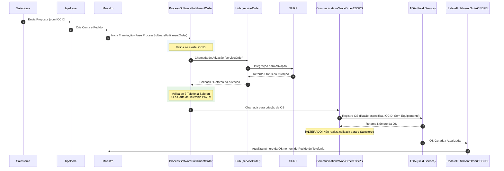
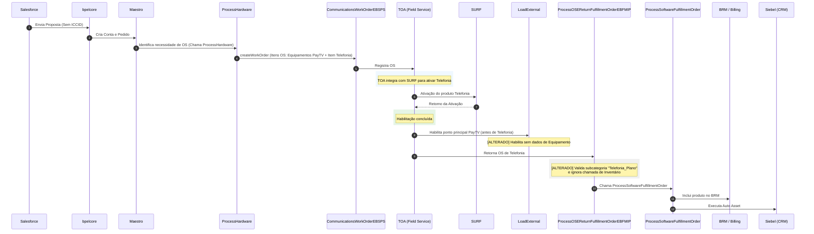

# Especificação Técnica: Ajustes na Integração SOA (Telefonia Solo e PayTV + Telefonia A La Carte)

Esta especificação descreve as alterações técnicas necessárias na camada de integração SOA para suportar dois fluxos principais de provisionamento de Telefonia: **Telefonia Solo** e **PayTV + Telefonia A La Carte**, incluindo os ajustes nos componentes de barramento para geração de Ordens de Serviço (OS), atualização de pedidos.

---

## 1. Visão Geral dos Fluxos

### 1.1. Fluxo 1: Telefonia Solo

Neste cenário, a proposta de telefonia solo é gerada com o ICCID previamente informado.

---

### 1.2. Fluxo 2: PAYTV + Telefonia A La Carte

Neste cenário, a proposta é gerada no Salesforce **sem** a informação do ICCID. A ativação do serviço de telefonia é realizada pelo TOA integrado com a SURF.

---

## 2. Detalhamento das Alterações

### 2.1. Ajustes Relacionados ao Fluxo 1 (Telefonia Solo)

#### A. Componente `ProcessSoftwareFulfillmentOrder`
* **Nova Condicional de Disparo da OS**:
  - **Cenário Atual**: O fluxo do `ProcessSoftwareFulfillmentOrder` **não gera OS em nenhum cenário**.
  - **Alteração**: Ajustar o fluxo para passar a gerar OS (chamando o `CommunicationsWorkOrderEBSPS`) **apenas** nos cenários de:
    * Pedido de inclusão de Salesforce de Telefonia Solo (após receber o callback de ativação da API `serviceOrder` do Hub).
    * Habilitação do a la carte de telefonia paytv do Salesforce.

#### B. Componente `CommunicationsWorkOrderEBSPS`
* **Ajuste no mapeamento da operação `createWorkOrder`**:
  - **Mapeamento do ICCID**: Ajustar a transformação/mapeamento XML no serviço para passar a informação do `iccid` no campo apropriado da Ordem de Serviço.
  - **Remoção de Dados de Equipamento**: Ajustar o mapeamento XML para garantir que **não** sejam enviados dados de equipamento no payload da requisição para este cenário de Telefonia.
* **Remoção do Callback para o Salesforce**:
  - **Alteração**: Remover/comentar a lógica de integração/callback voltada ao Salesforce neste fluxo específico de Telefonia.
  - > [!IMPORTANT]
    > **Observação**: Esta alteração de remoção de callback ainda está pendente de validação pela equipe responsável.

#### C. Componente `UpdateFulfillmentOrderOSBPEL`
* **Atualização do Número da OS no Item do Pedido**:
  - **Alteração**: Ajustar a lógica de busca e atualização para garantir que, ao receber o número da OS do TOA, o BPEL localize especificamente o **item do pedido de telefonia** correspondente dentro da estrutura do pedido e atualize o atributo do número da OS nele.

---

### 2.2. Ajustes Relacionados ao Fluxo 2 (PayTV + Telefonia A La Carte)

#### A. Componente `ProcessOSEReturnFulfillmentOrderEBFMIP`
* **Inclusão da Subcategoria "Telefonia_Plano"**:
  - **Cenário Atual**: O fluxo apenas executa o processamento de retorno para itens cuja categoria seja classificada como `"equipamento"`.
  - **Alteração**: Alterar as condicionais e validações de roteamento para passar a aceitar também itens que contenham a subcategoria `"Telefonia_Plano"`.
* **Desvio do Fluxo de Inventário**:
  - **Alteração**: Criar uma condicional (desvio) para que, quando o item processado pertencer à subcategoria de Telefonia, o BPEL **não** execute a chamada ao serviço de consulta/reserva de inventário físico de equipamentos.

#### B. Componente `LoadExternal`
* **Habilitação Sem Dados de Equipamento**:
  - **Cenário Atual**: O fluxo exige e processa informações obrigatórias relativas ao equipamento físico no ato da habilitação.
  - **Alteração**: Ajustar as validações e mapeamentos do fluxo para tornar o preenchimento de dados de equipamento opcional ou omiti-los inteiramente quando se tratar de itens de Telefonia, possibilitando que a habilitação (como a do ponto principal de PayTV ou posterior Telefonia) prossiga sem essas informações.

---

## 3. Matriz de Impacto (Alto Nível)

| Componente | Operação / Tipo | Resumo da Alteração | Fluxo Relacionado |
| :--- | :--- | :--- | :--- |
| `ProcessSoftwareFulfillmentOrder` | BPEL / Oracle SOA | Criar regra de decisão (Condition) para disparar a criação de OS apenas para os fluxos de "Telefonia Solo" (após callback). | Telefonia Solo |
| `CommunicationsWorkOrderEBSPS` | Mediator / BPEL | Ajustar mapeamento da operação `createWorkOrder` para enviar o `iccid` e remover os blocos de equipamento. Remover fluxo de resposta/callback destinado ao Salesforce *(Pendente de Validação)*. | Telefonia Solo |
| `UpdateFulfillmentOrderOSBPEL` | BPEL | Ajustar a atribuição (XPath/Assign) do número da OS para apontar especificamente ao item do pedido de Telefonia. | Telefonia Solo |
| `ProcessOSEReturnFulfillmentOrderEBFMIP` | BPEL | Adicionar suporte à subcategoria `"Telefonia_Plano"` nas validações e desviar (não executar) o serviço de inventário para esses itens. | PayTV + Telefonia A La Carte |
| `LoadExternal` | BPEL / OSB | Ajustar mapeamentos e regras para aceitar habilitação sem passagem de dados de equipamento físico. | PayTV + Telefonia A La Carte |
